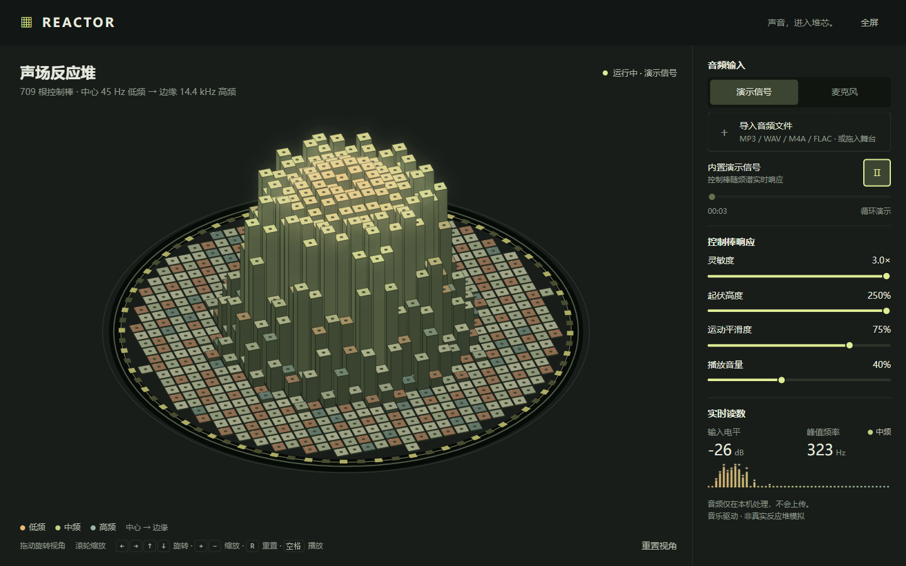

# Reactor Audio Visualizer

以切尔诺贝利反应堆堆芯的控制棒阵列为视觉原型的实时音频可视化实验。

网页使用 Web Audio API 在浏览器本机分析音频，将不同频段的能量映射为 709 根控制棒的升降运动：圆心为低频，边缘为高频。无需构建、无第三方依赖，`dist/` 即部署根目录。



## Features

- 三种音频输入：内置演示信号（8 个振荡器 + LFO）、本地音频文件（点击导入或直接拖入舞台）、麦克风。
- 播放 / 暂停（从暂停位置继续）、进度条拖动跳转（拖动时实时显示时间，松开后生效）。
- 灵敏度（音频驱动幅度，决定颜色与发光热度）、起伏高度（50%–250%，只决定棒升多高）、运动平滑度、播放音量调节。高度以舞台为基准做软限幅：中心棒顶最多升到舞台上四分之一处，之下不压缩，因此高度滑块在 250% 仍有效，棒也不会冲出舞台。
- 控制棒顶面按频段着色（低频 `#e6ba76`、中频 `#c5d185`、高频 `#99b4a9`），高能量控制棒按频段色发光（屏幕混合并按高亮棒数量限制总亮度，不会糊成一团白光），堆芯随整体能量泛光。
- 拖动旋转 / 倾斜视角（近侧跟随指针）、滚轮或双指捏合缩放、重置视角、全屏。
- 舞台标题下方一行说明频率映射（棒数、中心与边缘频率均由常量生成）；频段图例位于舞台左下角，紧挨数据。
- 实时读数：输入电平（dB）、峰值频率（Hz，旁边以对应频段色点标明低 / 中 / 高频）和带峰值保持的迷你频谱。
- 界面为单一文本字体（system-ui 中文栈），仅 `<kbd>` 按键使用等宽字体；无渐变、无静态阴影，焦点用描边环表示。
- 尊重 `prefers-reduced-motion`：无待机呼吸动画，画面静止时停止渲染循环；播放时仍然响应音频。
- 提供 `document.modelContext` 工具 `configure_reactor_response`（可选，用于调节灵敏度与平滑度）。

## Keyboard shortcuts

| 按键 | 作用 |
| --- | --- |
| `空格` | 播放 / 暂停（焦点在按钮或输入框时交给其自身处理） |
| `←` `→` `↑` `↓` | 旋转 / 倾斜视角（焦点在核心画布上时；`→` 与向右拖动一致，近侧向右） |
| `+` / `-` | 缩放 |
| `R` | 重置视角 |

## Run locally

```bash
python -m http.server 4173 --directory dist
```

Then open <http://localhost:4173>.

页面使用 ES Modules，需要通过 HTTP 访问（直接用 `file://` 打开会被浏览器拦截）。

## Tests

```bash
npm test
# 或
node --test tests/*.test.mjs
```

测试使用 `node:test`，无任何依赖，覆盖 `dist/js/math.js` 的全部纯函数（含软限幅与频段判定），并用桩对象校验 `input.js` 的拖动 / 方向键方向与双指缩放。（Node 22+ 下 `node --test tests/` 不再按目录展开，请使用上面的写法。）

## Project structure

```
dist/                  静态部署根目录（无构建步骤）
  index.html
  style.css
  js/
    main.js            入口：DOM 绑定、帧循环、读数节流、文件拖放
    ui.js              DOM 引用、中文文案、界面状态更新
    audio.js           AudioContext / 分析器、演示 / 文件 / 麦克风音源、播放控制与竞态保护
    renderer.js        核心画布：控制棒、高亮发光、堆芯泛光
    sprites.js         预渲染发光精灵与缓存的圆环 / 刻度
    rod-style.js       控制棒顶面 / 侧面的量化配色缓存
    spectrum.js        迷你频谱（频段着色、圆角、峰值保持）
    input.js           拖动、滚轮、键盘快捷键
    tool.js            modelContext 工具注册
    canvas.js          画布尺寸与 DPR（上限 2）
    math.js            纯函数：棒阵生成、频率 → FFT 频点映射、软限幅、频段判定、投影、配色、格式化
tests/math.test.mjs    math.js 的单元测试
tests/input.test.mjs   input.js 的拖动 / 方向键方向与双指缩放测试
```

## Notes

This is an audiovisual interaction experiment. It is not a physical simulation of a reactor, and audio is processed locally in the browser.

## Credits

本项目 fork 自 Andy Wang 的 [wzk112/reactor-audio-visualizer](https://github.com/wzk112/reactor-audio-visualizer)，在其基础上重写了前端：拆分为可读的 ES 模块、优化渲染性能、修复高灵敏度过曝与拖动方向，并新增起伏高度调节、文件拖放、键盘快捷键和单元测试。

## License

MIT. See [LICENSE](LICENSE). 原作者的版权声明保留在其中。
